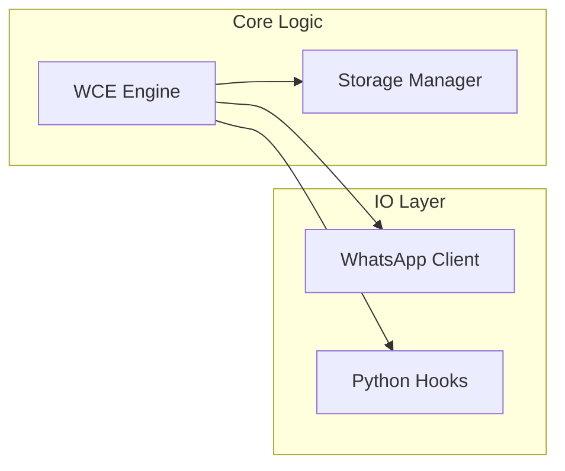

# PyWCE: Python WhatsApp ChatBot Engine

[](https://badge.fury.io/py/pywce)
[](https://opensource.org/licenses/MIT)

A high-performance, template-driven framework for creating complex WhatsApp chatbots with a clean, modular approach. PyWCE decouples conversational flow from business logic, allowing developers to scale their bots effortlessly.

## 🚀 Core Philosophy

PyWCE is built on two pillars:
1.  **Declarative Conversational Flows**: Define *what* happens in YAML/JSON.
2.  **Imperative Business Logic**: Define *how* it happens in Python hooks.

---

## 🏗️ Architecture

PyWCE is designed with modularity in mind. The core engine is decoupled from the WhatsApp client, allowing you to swap components or use the client independently.



### Key Technical Features
- **Decoupled Client**: Use `pywce.client` as a standalone WhatsApp library.
- **Pluggable Storage**: Implement `TemplateStorageManager` for custom backends (Redis, SQL, etc.).
- **Reflective Hooks**: Dynamically map Python functions to template actions using dotted paths.
- **State Management**: Built-in session handling with support for custom session providers.

---

## 🛠️ Installation

```bash
pip install pywce
```

---

## 🚦 Quick Start (FastAPI Example)

### 1. Define the Conversation Flow (`bot.yaml`)
```yaml
"START-MENU":
  type: button
  template: "app.hooks.get_user_name"
  message:
    title: "Welcome"
    body: "Hi {{ name }}, choose an option below:"
    buttons:
      - "Book Appointment"
      - "Contact Support"
  routes:
    "Book Appointment": "BOOKING-STAGE"
    "Contact Support": "SUPPORT-STAGE"
```

### 2. Implement the Business Logic (`hooks.py`)
```python
from pywce import HookArg, TemplateDynamicBody

def get_user_name(arg: HookArg) -> HookArg:
    # Logic to fetch or format user name
    arg.template_body = TemplateDynamicBody(
        render_template_payload={"name": arg.user.name}
    )
    return arg
```

### 3. Initialize the Engine
```python
from pywce import Engine, EngineConfig, client, storage

# Setup storage and client
storage_mgr = storage.YamlJsonStorageManager("./templates", "./triggers")
wa_client = client.WhatsApp(client.WhatsAppConfig(token="...", phone_number_id="..."))

# Configure and start engine
config = EngineConfig(whatsapp=wa_client, storage_manager=storage_mgr)
engine = Engine(config=config)
```

---

## 🧪 Testing & Debugging

We recommend using the [**WCE Emulator**](https://github.com/DonnC/wce-emulator) for local development. It allows you to test your bot without consuming Meta Cloud API credits or requiring a public webhook.

---

## 📚 Advanced Documentation

Detailed guides on hooks, session persistence, and media handling are available at [docs.page/donnc/wce](https://docs.page/donnc/wce).

---

## 🤝 Contributing & License

We love contributions! Please read our [Contributing Guide](./CONTRIBUTING.md).
Licensed under the [MIT License](./LICENSE).
