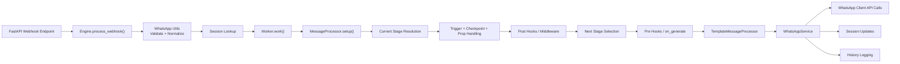
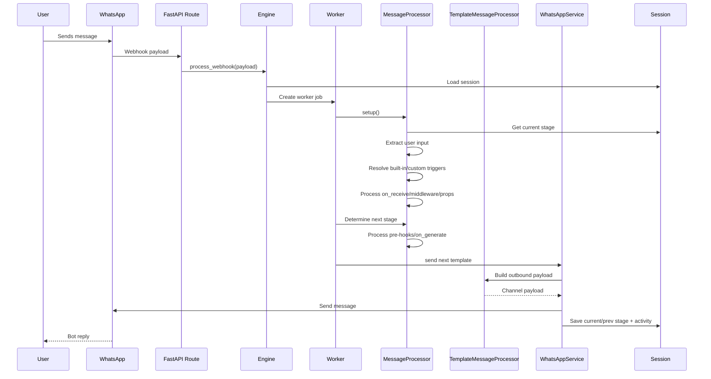
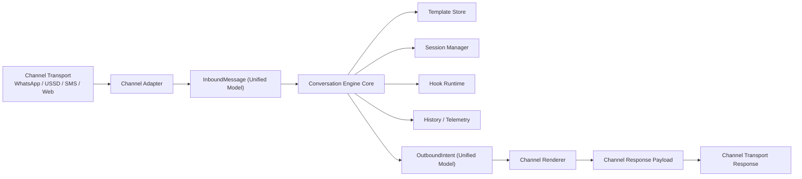
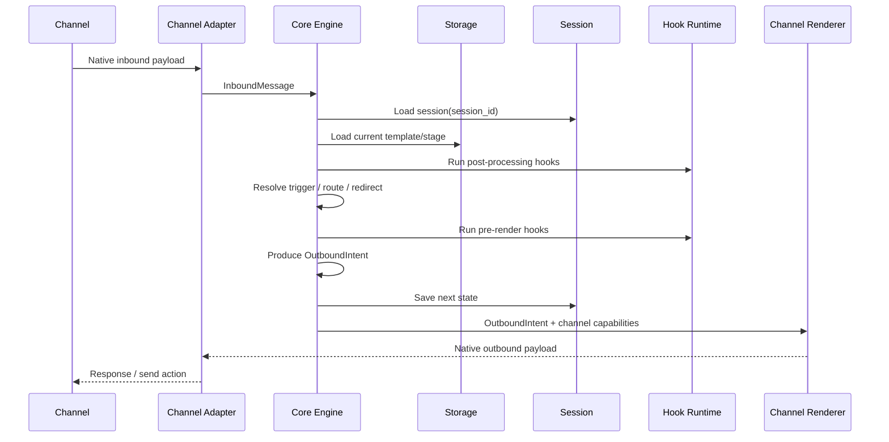

# pywce Evolution Plan

## Purpose

> Scope update:
> `pywce` remains a Python and WhatsApp-focused engine.
> The channel-agnostic unified core direction is now intended for the Java-side `jawce` project instead.
> This document is therefore best read as an architectural thought exercise and reference, not the active implementation direction for `pywce`.

This document turns the earlier project assessment into a concrete next-step plan.

The direction here assumes:

- the current `pywce` engine is worth preserving,
- test-first development is the non-negotiable rule,
- session persistence is intentionally out of scope for now because the session manager is already abstracted and can be swapped later,
- the immediate architectural goal is to make the engine mature enough to power multiple conversational channels, especially a future USSD adapter.

## Guiding Rule

`TDD first before any custom logic.`

That rule is especially important for `pywce` because the core value of the project is orchestration behavior, not isolated utility functions. The biggest risks are regressions in routing, trigger behavior, hook timing, and session transitions. That means the right unit of confidence is not just a function-level test, but engine-level behavior tests.

## Current State

Today, `pywce` is best understood as a WhatsApp-first conversation engine with reusable core concepts.

The reusable concepts already exist:

- stage-based routing,
- template-driven flow definitions,
- hook-based business logic,
- session-backed conversation state,
- pluggable storage and session abstractions.

The WhatsApp-specific parts are still too close to the core for the package to be called truly channel-agnostic, but the foundation is good enough to evolve in that direction.

## Current Architecture

## Current Runtime Flow

## What Needs Hardening First

These are the areas I would harden before pushing into multi-channel ambitions.

## 1. Behavior-first test coverage

This is the first and most important area.

Before refactoring the core, the current engine behavior should be locked down with tests that describe how the system behaves today. These are characterization tests and they protect the refactor from accidental semantic drift.

Recommended first test slices:

- first-time user lands on `start_template_stage`,
- static route transition from button and text input,
- built-in trigger behavior for `menu`, `back`, `retry`, `report`,
- checkpoint resume behavior,
- `prop` persistence into session props,
- `router` hook redirect behavior,
- `template` hook dynamic rendering behavior,
- `on_receive` and `on_generate` execution order,
- duplicate webhook rejection,
- debounce suppression,
- stale webhook rejection,
- inactivity reset behavior,
- failure handling for `HookException`, `EngineResponseException`, and session errors.

## 2. Runtime contract tests

Once engine behavior tests exist, add adapter contract tests around the current WhatsApp integration.

Examples:

- text template becomes `send_message`,
- button/list/flow templates become `send_interactive`,
- media template becomes `send_media`,
- location template becomes `send_location`,
- unsupported combinations fail fast and clearly.

This is important because future channel support should be validated against the same style of contract.

## 3. Template graph validation

Before runtime, the engine should be able to validate a flow graph.

Suggested checks:

- every route target exists,
- start/report stages exist,
- required fields exist for each template kind,
- unsupported hook names are rejected,
- templates with incompatible settings are flagged,
- unreachable stages are reported,
- cycles are either allowed explicitly or reported clearly.

This would move a class of failures from runtime to authoring time.

## 4. More explicit core semantics

The current engine is already a state machine, but the semantics are partly implicit across `Worker`, `MessageProcessor`, and `WhatsAppService`.

Hardening means making the rules more explicit:

- what counts as current stage versus next stage,
- when post-hooks run versus pre-hooks,
- when a trigger overrides stage routing,
- which template kinds are input-processing versus output-only,
- what session bypass really means,
- when the engine should mutate session state and when it should not.

These rules should be captured both in tests and in internal docs.

## Why USSD Is A Good Architectural Target

USSD is stricter than WhatsApp, so it is a good forcing function.

USSD typically requires:

- text-only output,
- menu-style choices,
- short request/response cycles,
- explicit session identifiers,
- compact interaction patterns,
- deterministic transitions,
- clear timeout and invalid-input behavior.

If the core can support USSD cleanly, it will almost certainly be cleaner and more reusable for SMS, Telegram-like menu bots, web chat, and other channels too.

## The Core Design Shift

The right next move is not to bolt USSD directly into the current WhatsApp-first pipeline. The better move is to extract a channel-neutral core while keeping WhatsApp as the first adapter.

The target split should be:

- `core engine`
- `channel adapters`
- `channel renderers`
- `template validation and compilation`

## Proposed Unified Channel-Agnostic Architecture

## Proposed Unified Process Flow

## Key New Abstractions

To get there cleanly, I would introduce these abstractions.

## 1. `InboundMessage`

A unified inbound model independent of transport.

Suggested fields:

- `channel`
- `session_id`
- `user_id`
- `message_id`
- `timestamp`
- `input_type`
- `text`
- `selection`
- `location`
- `media`
- `metadata`
- `raw_payload`

This replaces the current assumption that inbound parsing is fundamentally a WhatsApp utility concern.

## 2. `OutboundIntent`

A unified response model from the engine before channel rendering.

Suggested intent types:

- `text`
- `menu`
- `input_prompt`
- `choice_prompt`
- `media`
- `location_request`
- `template`
- `handoff`
- `end_session`

This is important because the engine should decide what it wants to say, while the renderer decides how a channel can express it.

## 3. `ChannelAdapter`

Each adapter should do three jobs only:

- parse native input into `InboundMessage`,
- expose channel capabilities,
- deliver or return channel-native output.

For example:

- WhatsApp adapter supports media, interactive buttons, lists, flow, reactions, location requests.
- USSD adapter supports text, menu prompts, numeric selection, session end.

## 4. `ChannelRenderer`

This maps `OutboundIntent` into channel-specific output.

Examples:

- an engine `menu` intent becomes interactive buttons on WhatsApp,
- the same `menu` intent becomes numbered text on USSD,
- a `media` intent is valid for WhatsApp but should fail or degrade for USSD.

## 5. `Capability-aware flow validation`

A channel-agnostic core still needs channel-aware validation.

Examples:

- a flow using `media` should be valid for WhatsApp,
- the same flow should be rejected, degraded, or transformed for USSD,
- some templates may be marked as channel-specific,
- some flows may be declared portable across channels.

This avoids pretending every stage can run everywhere.

## Concrete Refactor Phases

The cleanest path is incremental.

## Phase 1. Freeze current behavior with tests

Do not refactor first.

Add:

- engine-level behavior tests,
- hook lifecycle tests,
- route resolution tests,
- WhatsApp adapter contract tests.

Exit criteria:

- current behavior is captured well enough that refactoring can proceed safely.

## Phase 2. Introduce unified models without changing behavior

Add:

- `InboundMessage`,
- `OutboundIntent`,
- a thin internal mapping layer from current WhatsApp structures into those models.

Keep the public API working exactly as today.

Exit criteria:

- the WhatsApp path still passes all existing tests,
- the engine can internally reason in unified models even if only one adapter exists.

## Phase 3. Extract a channel-neutral engine core

Move WhatsApp-specific assumptions outward.

The core should own:

- stage resolution,
- trigger logic,
- checkpoint logic,
- route evaluation,
- hook invocation policy,
- session updates,
- intent production.

The WhatsApp adapter should own:

- webhook parsing,
- WhatsApp response formatting,
- API-specific send semantics.

Exit criteria:

- the core engine no longer depends on WhatsApp enums or payload shapes.

## Phase 4. Add template validation and capability checks

Add:

- static flow validator,
- per-channel compatibility validator,
- authoring-time errors for unsupported kinds and bad routes.

Exit criteria:

- invalid flows fail before runtime,
- portable flows can be identified clearly.

## Phase 5. Build a minimal USSD adapter

Keep the first USSD adapter intentionally small.

Support only:

- text prompts,
- menu prompts,
- simple free-text input,
- invalid input retries,
- explicit session end.

Do not try to support all current template kinds in the first cut.

Exit criteria:

- one simple demo flow runs on both WhatsApp and USSD from the same core engine.

## Phase 6. Expand shared authoring patterns

Once the core is stable:

- introduce portable template subsets,
- document channel-specific escape hatches,
- define degradation rules,
- possibly introduce a flow compiler or linter.

## Recommended Test Strategy

Since TDD is the rule, I would structure tests like this:

## Engine behavior tests

Focus on:

- stage transitions,
- trigger precedence,
- checkpoint behavior,
- inactivity behavior,
- hook ordering,
- error recovery behavior.

## Template validation tests

Focus on:

- bad route targets,
- missing required fields,
- unsupported kinds,
- malformed triggers,
- channel capability conflicts.

## Adapter contract tests

One suite per adapter, same expectations pattern.

Focus on:

- inbound parse correctness,
- outbound render correctness,
- unsupported capability behavior.

## Golden flow tests

Create a few canonical cross-channel flows:

- simple menu flow,
- data capture flow,
- retry/report/back flow.

Run them across adapters where supported.

## What I Would Not Do Yet

To keep the evolution disciplined, I would avoid:

- adding many new channel features before extracting unified models,
- over-designing persistence now,
- trying to make every WhatsApp feature portable,
- introducing a massive breaking API change before tests exist.

## Bottom Line

Yes, `pywce` can become mature enough to power a USSD gateway and other conversational channels, but the path is to treat WhatsApp as the first adapter, not the core identity of the engine.

The current project already has the right instincts:

- interfaces,
- stage-based flows,
- hook-driven extensibility,
- session-backed orchestration.

What it needs next is not a rewrite. It needs a TDD-first extraction of a unified conversation core, followed by capability-aware channel adapters. That would let the project grow from "WhatsApp chatbot engine" into a more general conversation engine without losing the strengths it already has.
